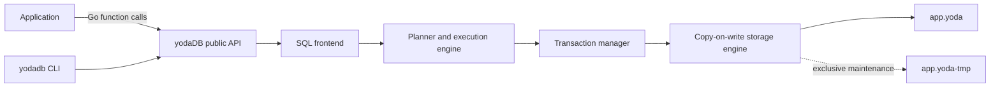
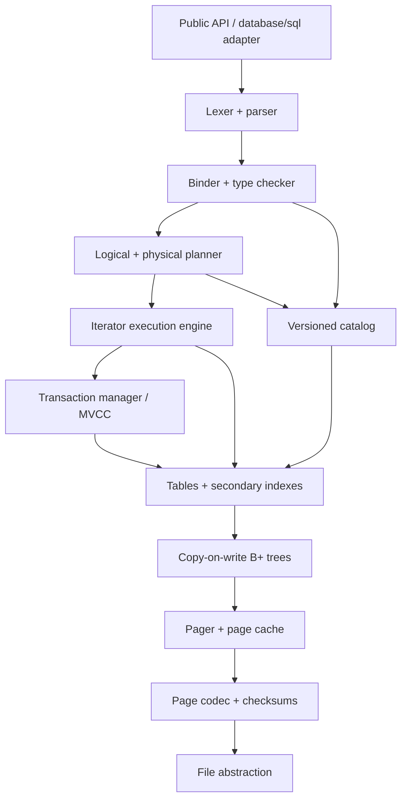
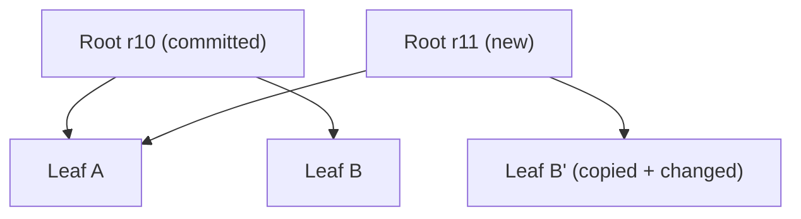
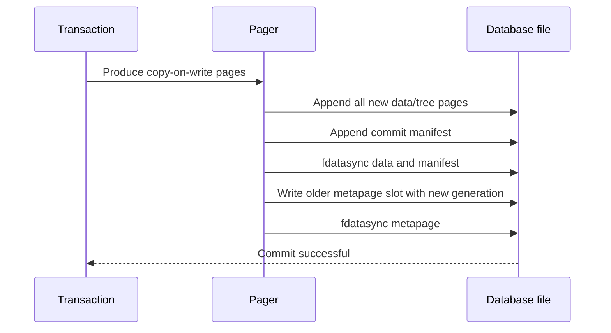
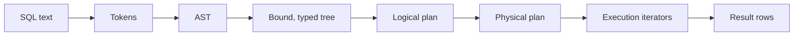
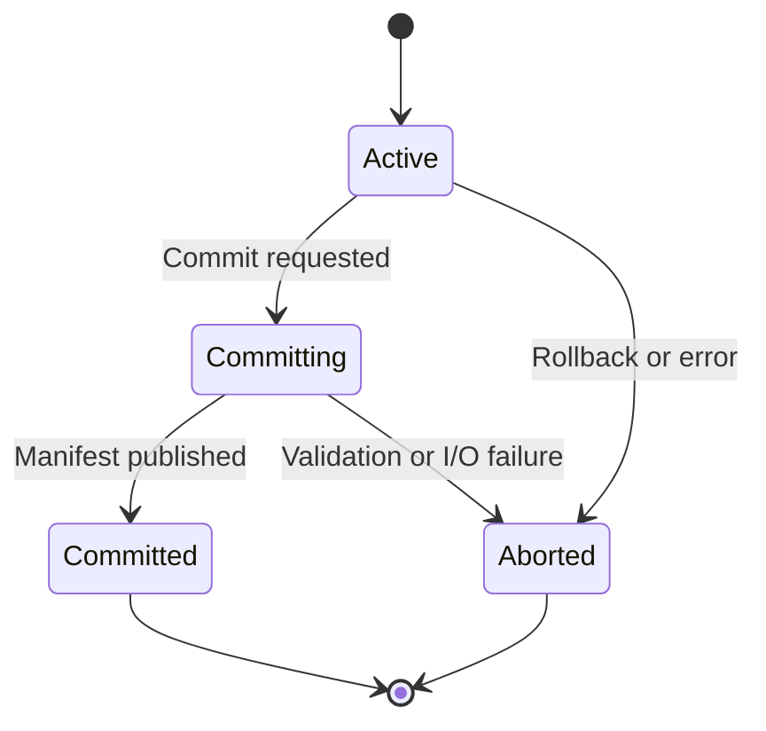
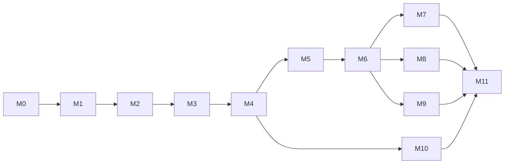

# yodaDB: end-to-end architecture and implementation plan

Status: **authoritative working plan**  
Language: **Go**  
Repository: **yodaDB**  
Primary artifact: an embedded library plus a small CLI  
Target v1: a strictly typed, durable, single-file relational database with SQL,
indexes, snapshot transactions, optimistic concurrent writers, checksummed
pages, history, and changefeeds.

---

## 1. Vision

yodaDB is a learning database, but it should be engineered as a real system. It
will keep the deployment virtues of SQLite—an embedded library, no daemon, and
one primary database file—while exploring a different storage architecture:

- strict and predictable types by default;
- immutable committed pages and copy-on-write updates;
- snapshot isolation with explicit transaction IDs;
- optimistic multi-writer transactions inside one process;
- checksums and actionable corruption diagnostics;
- version history and logical changefeeds as storage-level concepts;
- predictable foreground commits, with maintenance separated from query work.

The project is successful even if it never rivals SQLite. The learning goal is
to understand and implement the complete path from SQL text to durable bytes,
including failure behavior.

### 1.1 Product principles

1. **Correctness before speed.** A slow correct transaction is more useful than
   a fast database that cannot explain its crash behavior.
2. **Small, explicit semantics.** Unsupported SQL returns a clear error; it is
   never silently approximated.
3. **Storage is observable.** A diagnostic tool can explain pages, roots,
   transactions, free space, and corruption.
4. **Committed data is immutable.** Updates create new pages or row versions.
5. **Features arrive as vertical slices.** Each milestone ends in something a
   user can run and test.
6. **Format evolution is designed in.** Every persisted structure is versioned.

### 1.2 Non-goals for v1

- No server process, network protocol, authentication, or user management.
- No distributed consensus or cross-machine replication.
- No support for a database actively shared over a network filesystem.
- No complete SQL standard, stored procedures, triggers, or window functions.
- No cross-process concurrent writers in v1. Multiple handles in one process are
  supported first; cross-process coordination is a later experiment.
- No transparent encryption in the initial format.
- No lock-free algorithms or use of `unsafe` without an accepted ADR.

---

## 2. User-facing target

### 2.1 Embedded Go API

The public API should feel like a Go library, not a server client:

```go
db, err := yodadb.Open("app.yoda", yodadb.Options{})
if err != nil { /* handle */ }
defer db.Close()

_, err = db.Exec(ctx, `
    CREATE TABLE users (
        id   INT64 PRIMARY KEY,
        name TEXT NOT NULL
    )
`)

_, err = db.Exec(ctx, `INSERT INTO users VALUES (?, ?)`, int64(1), "Ada")

rows, err := db.Query(ctx, `SELECT name FROM users WHERE id = ?`, int64(1))
```

After the native API stabilizes, implement `database/sql/driver` as an adapter.
Do not distort the core API merely to match `database/sql` limitations.

### 2.2 CLI

```text
yodadb app.yoda
yoda> CREATE TABLE users (id INT64 PRIMARY KEY, name TEXT NOT NULL);
yoda> INSERT INTO users VALUES (1, 'Ada');
yoda> SELECT * FROM users;
1 | Ada
```

Diagnostic commands will eventually include:

```text
yodadb inspect app.yoda
yodadb check app.yoda
yodadb pages app.yoda --tree users
yodadb history app.yoda --from 100 --to 120
yodadb compact app.yoda
```

The M0 scaffold uses Go's standard `flag` package while the CLI has only help
and version flags. Introduce Cobra in M2.7, when the first diagnostic subcommand
creates a real command hierarchy. Cobra owns argument parsing, help, and command
wiring only; command handlers call library APIs and must not contain database,
storage, or SQL-engine logic.

### 2.3 Initial SQL dialect

Supported incrementally:

- `CREATE TABLE`, `DROP TABLE`;
- `CREATE [UNIQUE] INDEX`, `DROP INDEX`;
- `INSERT`, `UPDATE`, `DELETE`;
- `SELECT ... FROM ...`;
- `WHERE` with comparisons, Boolean operators, and `IS NULL`;
- projection and aliases;
- `ORDER BY`, `LIMIT`, `OFFSET`;
- inner nested-loop and index joins;
- `COUNT`, `MIN`, `MAX`, `SUM`, `AVG`, then `GROUP BY`;
- `BEGIN`, `COMMIT`, `ROLLBACK`;
- parameter placeholders `?`;
- later: `AS OF TRANSACTION <id>` for historical reads.

Explicitly deferred: subqueries, CTEs, outer joins, `HAVING`, set operations,
triggers, views, generated columns, and window functions.

---

## 3. System context



There is no socket and no daemon. The application process owns the database
engine. `app.yoda` is the primary persistent artifact. A lock sidecar may exist
while the database is open, and compaction may create a temporary replacement.
These are operational companions, not separate logical databases.

---

## 4. Target architecture

### 4.1 Layering



Layering rules:

- SQL packages know about schemas and values, but not file offsets.
- Storage packages know about byte encodings, pages, trees, and transaction IDs,
  but not SQL tokens or syntax.
- The transaction manager coordinates storage roots and logical constraints.
- The catalog is ordinary versioned data accessed through a narrow interface.
- All disk I/O passes through the VFS so crash and fault tests can replace it.

### 4.2 Proposed package layout

```text
cmd/yodadb/             interactive shell and diagnostic subcommands
db/                     public DB, Tx, Rows, Result API
driver/                 optional database/sql adapter
sql/lexer/              tokens and source locations
sql/parser/             AST and recursive-descent parser
sql/binder/             name resolution and type checking
sql/plan/               logical and physical plans
sql/exec/               iterator operators and expression evaluation
types/                  scalar types, Value, tuple/key codecs
catalog/                tables, columns, indexes, schema versions
txn/                    snapshots, read/write sets, validation, commits
storage/vfs/            file interface and OS implementation
storage/page/           page IDs, headers, checksum, slotted pages
storage/pager/          reads, append allocation, cache, pinning
storage/btree/          copy-on-write B+ tree
storage/manifest/       commit manifests and metapages
storage/compact/        reachability and exclusive compaction
changefeed/             logical changes and subscribers
internal/testutil/      fixtures, model checks, fault injection
docs/adr/               architecture decision records
testdata/               golden SQL, format, and corrupt-file fixtures
```

Avoid cyclic dependencies. Shared interfaces belong at the consumer boundary,
not in a generic `common` package.

---

## 5. Core data model

### 5.1 Types

Initial scalar types:

| Type | Logical representation | Ordering |
|---|---|---|
| `NULL` | absence | sorts first initially; document explicitly |
| `BOOL` | true/false | false before true |
| `INT64` | signed 64-bit integer | numeric |
| `FLOAT64` | IEEE 754 | total ordering policy must cover NaN |
| `TEXT` | valid UTF-8 string | binary code-point order initially |
| `BYTES` | arbitrary bytes | lexicographic |

Add `DECIMAL`, `DATE`, `TIMESTAMP`, `UUID`, and `JSON` only after the initial
codec, comparison, and index semantics are stable.

Rules:

- Columns are strict by default.
- Implicit conversions are minimal and lossless only.
- `NULL` is not equal to anything, including `NULL`; use `IS NULL`.
- Keys use a canonical order-preserving encoding. Tuple storage encoding and
  index-key encoding may differ.
- Collation is part of an index definition. v1 implements only binary collation.

### 5.2 Schema

Every table has:

- stable `TableID` independent of its name;
- monotonically increasing schema version;
- stable `ColumnID`s so rename does not change stored identity;
- primary-key definition or a hidden `RowID`;
- zero or more secondary indexes.

Every index has a stable `IndexID`, ordered key columns, uniqueness flag, and a
root page recorded in the commit manifest.

### 5.3 Rows and tuples

Rows are encoded independently of Go struct layout:

```text
TupleHeader
  formatVersion  u8
  schemaVersion  uvarint
  columnCount    uvarint
  nullBitmap     []byte
  offsets        []uvarint   // variable-width fields
Payload
  encoded non-null values
```

Requirements:

- Bounds-check every decode operation.
- Never panic on malformed persisted bytes; return a corruption error with page
  and slot context.
- Unknown future format versions fail cleanly.
- Limit row and value sizes through configurable, tested limits.
- Large values initially fail with `ErrValueTooLarge`; overflow pages are a
  post-v1 extension rather than hidden complexity.

---

## 6. Physical storage

### 6.1 File and page model

The file is divided into fixed-size pages. Start with 4 KiB pages while allowing
the size to be recorded in the format header for future databases.

```text
offset(pageID) = pageID * pageSize
```

Reserved pages:

- Page 0: format header and metapage A
- Page 1: format header and metapage B
- Page 2 onward: immutable data, tree, overflow, and manifest pages

Metapages are the only committed pages intentionally overwritten. Data pages are
append-allocated and immutable after publication.

### 6.2 Common page header

Conceptual format; exact byte offsets must be fixed by an ADR before M2:

```text
magic          [4]byte
formatVersion  uint16
pageType       uint8
flags          uint8
pageID         uint64
generation     uint64
payloadLength  uint16
reserved       uint16
checksum       uint64
payload        [payloadLength]byte
```

Checksums cover the header with the checksum field zeroed plus the payload.
Choose a well-supported deterministic checksum after benchmarking; correctness
tests must not depend on a particular hardware implementation.

Page types include `Meta`, `Manifest`, `BTreeInternal`, `BTreeLeaf`, `Catalog`,
and later `FreeMap`/`History` if necessary.

### 6.3 Slotted leaf pages

Variable-length leaf entries use a slotted-page layout:

```text
┌─────────────────────────────────────────────────────────┐
│ common header │ slot 0 │ slot 1 │ ... │ free space     │
│                                        ... │ records ← │
└─────────────────────────────────────────────────────────┘
```

Slots remain fixed-width and point to packed records at the end of the page.
Insertion can rearrange record bytes within an uncommitted page. Once committed,
the page never changes.

### 6.4 Copy-on-write B+ tree

Tables and indexes are B+ trees:

- internal pages contain separator keys and child page IDs;
- leaf pages contain ordered key/value entries and optional sibling references;
- reads traverse from the snapshot's root;
- a mutation copies the affected path, producing a new root;
- splits propagate upward; root splitting creates a new root page;
- deletion begins with tombstones/no merge, then later adds redistribution and
  merge after insertion and recovery are stable;
- a tombstone retains its key for ordering and separator routing, stores no
  value, and is omitted by lookup and cursor APIs.



The old root remains readable by old snapshots. This structural sharing is the
foundation for MVCC and history.

### 6.5 Metapages and manifests

A commit manifest contains:

```text
transaction ID
parent transaction ID
commit timestamp (informational, not ordering authority)
catalog root page ID
table root map: TableID -> PageID
index root map: IndexID -> PageID
logical change range or root
oldest retained transaction ID
manifest checksum
```

Metapages A and B contain the file identity, page size, format version, latest
transaction ID, and latest manifest page ID. Each has a generation and checksum.
Open selects the highest-generation valid metapage whose manifest and referenced
roots validate structurally at the required shallow level.

### 6.6 Atomic commit protocol

Single-writer protocol first:



The metapage publication is the logical commit point. If a crash occurs before
it, appended pages are unreachable garbage. If it occurs after it, the new
manifest must be recoverable. Never acknowledge commit before the final required
sync under the selected durability mode.

Provide explicit durability modes eventually:

- `DurabilityFull`: data and commit metadata synced before success.
- `DurabilityProcess`: survives process crashes, not promised for power loss.
- Tests always know which mode they exercise; never silently weaken defaults.

The feasibility of the double-metapage protocol across supported filesystems
must be validated in M5. If assumptions are not defensible, introduce a small
checksummed commit journal. That change requires an ADR and crash-test evidence.

### 6.7 Compaction and reclamation

Append-only copy-on-write produces unreachable pages. Initial policy:

- do not reuse page IDs in the normal write path;
- expose file size, live bytes, garbage bytes, and oldest snapshot;
- implement exclusive offline compaction into `database.yoda-tmp`;
- sync the replacement and its directory before atomic rename;
- retain the original until the replacement is fully validated.

Online/background compaction is post-v1. It must not be implemented until page
reachability, snapshot pinning, and crash-safe replacement are proven.

---

## 7. SQL pipeline



### 7.1 Lexer and parser

- Hand-written lexer preserving byte offset, line, and column.
- Hand-written recursive-descent/Pratt parser.
- Parser reports expected tokens and a source span.
- AST retains identifiers separately from resolved catalog IDs.
- Use golden tests for valid and invalid SQL.
- Fuzz lexer/parser from their first milestone; arbitrary bytes must not panic.

### 7.2 Binder and type checker

The binder:

- resolves table aliases and columns;
- replaces names with stable table/column IDs;
- detects ambiguous and missing names;
- assigns a type and nullability to every expression;
- inserts only approved lossless coercions;
- validates aggregate and grouping rules.

### 7.3 Planner

Begin with deterministic rules, not a cost-based optimizer:

1. Build logical scan/filter/project/join/sort/limit nodes.
2. Push filters near scans when semantics allow.
3. Use a primary or secondary index for equality/range predicates matching an
   index prefix.
4. Otherwise use a full table scan.
5. Use nested-loop joins, selecting an indexed inner side when possible.

Later collect basic statistics—row count, distinct estimate, min/max—and add a
small cost model. Plans must be explainable through `EXPLAIN` before they become
adaptive or sophisticated.

### 7.4 Execution engine

Use pull-based iterators initially:

```go
type Operator interface {
    Open(context.Context) error
    Next(context.Context) (types.Row, error) // io.EOF at end
    Close() error
}
```

Operators include table scan, index scan, values, filter, projection, insert,
update, delete, nested-loop join, sort, limit, and aggregate.

Rules:

- Context cancellation is checked at bounded intervals.
- `Close` is idempotent and releases snapshot/page pins.
- Expression evaluation is centralized so scans and filters cannot disagree.
- Operators return structured errors and never print.

---

## 8. Transactions, MVCC, and concurrency

### 8.1 Transaction identity and snapshots

Every committed transaction receives a monotonically increasing `TxnID`.
A transaction begins with a snapshot referring to a committed manifest/root set.
All reads use that root set regardless of later commits.

States:



### 8.2 Isolation target

v1 target is **snapshot isolation**:

- reads observe a stable committed snapshot;
- a transaction reads its own writes;
- uncommitted changes are invisible to other transactions;
- write/write conflicts cause one transaction to abort;
- write skew is possible and must be documented.

Serializable isolation via predicate/range tracking is a post-v1 research item.

### 8.3 Multi-writer strategy

Build in three stages:

1. **Single active writer, multiple snapshot readers.** Establish correctness.
2. **Concurrent transaction preparation.** Transactions buffer logical mutations
   and tentative COW pages; commit remains serialized.
3. **Optimistic validation and rebase.** Track row keys, unique-index keys, and
   relevant catalog objects. At commit, validate against transactions committed
   since the base snapshot. Non-conflicting changes are replayed/rebased on the
   latest roots, then published under a short commit mutex.

```mermaid
sequenceDiagram
    participant A as Writer A
    participant B as Writer B
    participant C as Commit coordinator
    A->>A: Read snapshot 40 and prepare changes
    B->>B: Read snapshot 40 and prepare changes
    A->>C: Validate write set
    C-->>A: Publish transaction 41
    B->>C: Validate against 41
    alt disjoint keys
        C->>C: Rebase B on roots from 41
        C-->>B: Publish transaction 42
    else conflicting keys
        C-->>B: ErrConflict; caller may retry
    end
```

Constraints participate in validation. Two transactions inserting the same
unique key conflict even if their hidden row IDs differ.

Do not hold the commit mutex during SQL parsing, scans, expression evaluation,
or user code. Initially it may cover validation, COW replay, and publication;
measure and shorten it only after correctness tests exist.

### 8.4 History retention

Committed manifests form a parent-linked chain. Retention policy determines how
far historical snapshots remain addressable:

- default may retain the last N commits or a size budget;
- active snapshots pin their referenced versions;
- explicit named snapshots may pin history;
- compaction may reclaim only pages unreachable from every retained root.

Wall-clock timestamps are metadata. `TxnID`, not time, is the exact history key.

---

## 9. Catalog and schema evolution

The catalog is transactional. DDL and data changes in one transaction become
visible atomically through the new manifest.

Initial catalog entities:

- database format/schema version;
- table descriptors;
- column descriptors with stable IDs and types;
- index descriptors;
- root references where not already held directly by the manifest;
- allocation counters for stable IDs.

Schema evolution stages:

1. Add nullable column or constant-default column as metadata-only change.
2. Rename table/column by changing names while retaining IDs.
3. Drop column logically; physical bytes remain until compaction.
4. Add index by building against a snapshot, then validating/catching up before
   transactional publication.
5. Type change requires explicit conversion policy and may run as a rewrite.

Rows carry schema versions. The row decoder materializes missing newer columns
from their default or `NULL`. Do not make every query branch on SQL text stored in
the catalog; compile schema descriptors when a snapshot is opened.

---

## 10. Changefeed and historical queries

Each committing transaction records logical changes separately from physical
page rewrites:

```go
type Change struct {
    TxnID   TxnID
    TableID TableID
    Kind    Insert | Update | Delete
    Key     Key
    Before  *Row // optional/configurable
    After   *Row // optional/configurable
}
```

Requirements:

- Ordering is transaction order, then stable statement/row order.
- Consumers resume from a transaction ID.
- A retention error clearly states when the requested point was compacted away.
- Slow in-process subscribers cannot block commits indefinitely; durable reading
  comes from persisted history, not an unbounded Go channel.
- Physical B+ tree page changes never appear as user changes.

Historical reads bind catalog and table roots from the requested manifest:

```sql
SELECT * FROM users AS OF TRANSACTION 1052 WHERE id = 7;
```

---

## 11. Error model and diagnostics

Define errors suitable for `errors.Is`/`errors.As`:

- syntax and source-span errors;
- bind errors: unknown/ambiguous object;
- type and constraint errors;
- transaction conflict and closed-transaction errors;
- cancellation and timeout;
- unsupported-feature errors;
- I/O errors preserving the underlying error;
- corruption errors carrying file, page ID, page type, slot/key context, and the
  failed invariant.

Never turn corruption into an empty result or silently skip a damaged record.
The checker may support a deliberate salvage mode, but ordinary query execution
fails closed.

`yodadb check` grows in levels:

1. validate metapages and manifest chain;
2. validate checksums for reachable pages;
3. validate B+ tree ordering, bounds, and reachability;
4. validate tuple decoding and schema references;
5. validate primary/secondary index agreement and constraints.

---

## 12. Testing and verification strategy

### 12.1 Test pyramid

- Unit tests for codecs, comparisons, parsing, expressions, and page operations.
- Property tests/model tests for B+ tree behavior against a Go sorted map model.
- Fuzz tests for lexer, parser, tuple decoder, page decoder, and tree operations.
- Integration tests that execute SQL through the public API.
- Golden tests for SQL diagnostics, plans, and on-disk fixture inspection.
- Crash tests that terminate at every injected persistence boundary.
- Concurrency tests with deterministic scheduling and randomized stress.
- Compatibility tests that open format fixtures written by older releases.

### 12.2 Required global checks

Run for every completed task where applicable:

```text
gofmt on changed Go files
go vet ./...
go test ./...
go test -race ./...
```

Add linting only when its configuration is committed and low-noise. Do not make
the project depend on a globally installed unpinned tool.

### 12.3 Fault-injection VFS

The VFS test double must support:

- fail the Nth read/write/sync/truncate;
- short reads and writes;
- torn writes at configured byte offsets;
- reordered visibility of writes versus sync;
- simulated process crash discarding unsynced bytes;
- deterministic operation log for test assertions.

Crash testing algorithm:

1. Generate a known pre-transaction database.
2. Execute a transaction once while recording VFS operations.
3. Re-run and crash after each operation boundary.
4. Reopen with recovery.
5. Assert the database is exactly the old state or the fully committed new state,
   never a mixture.

### 12.4 Reference model

For randomized SQL subsets, maintain a simple in-memory relational model. Apply
the same generated operations to yodaDB and the model, then compare results and
constraint outcomes. SQLite may be used as a secondary semantic comparison only
where yodaDB deliberately shares its semantics.

---

## 13. Performance method

Correctness gates precede performance gates. Benchmarks should report workload,
database size, durability mode, Go version, OS/filesystem, and percentile
latencies rather than only operations per second.

Initial benchmarks:

- point lookup by primary key;
- sequential scan at several row counts;
- single-row durable insert;
- batched insert transaction;
- B+ tree split-heavy random inserts;
- N readers plus one writer;
- later, disjoint and conflicting concurrent writers;
- open/recovery time with long history;
- compaction throughput and temporary disk use.

Do not set absolute SQLite-beating targets for v1. Track regressions against
yodaDB baselines and explain large changes.

---

## 14. Security and resource limits

Even an embedded database consumes untrusted inputs. Enforce configurable limits
for SQL length, nesting depth, columns, row size, value size, parameter count,
page count, transaction write bytes, sort memory, and retained history.

- Decoders use checked arithmetic and validate offsets before slicing.
- Temporary sort data has a bounded-memory design before large inputs are
  advertised; otherwise return a resource-limit error.
- Database paths are supplied by the host application; yodaDB does not interpret
  SQL strings as filesystem paths in v1.
- Diagnostics redact bound values unless explicitly enabled.

---

## 15. Milestones and distributed task backlog

Task IDs are stable coordination handles for coding agents. A task may begin only
when its listed dependencies are complete. Each milestone has one integration
owner—even if several agents implement tasks—to prevent incompatible package
boundaries from landing simultaneously.

### M0 — Repository and engineering foundation

Outcome: every later change has reproducible commands and documented decisions.

Status: **[x] verified (2026-08-05)**

| ID | Status | Task | Depends on | Deliverable |
|---|---|---|---|---|
| M0.1 | [x] verified | Repository scaffold | — | packages, `cmd/yodadb`, license decision, README |
| M0.2 | [x] verified | Test/build commands | M0.1 | Makefile or Go-native scripts, CI configuration |
| M0.3 | [x] verified | ADR process | M0.1 | ADR template and first architecture ADRs |
| M0.4 | [x] verified | Error conventions | M0.1 | structured base errors and tests |
| M0.5 | [x] verified | Benchmark harness | M0.2 | reproducible benchmark package and reporting notes |

Required ADRs: page size/endianness, checksum algorithm, durability contract,
metapage commit assumptions, SQL identifier casing, and public API stability.

Gate:

- `go test ./...` and `go test -race ./...` pass in CI.
- `go run ./cmd/yodadb --help` works.
- Package dependency direction is documented.

### M1 — In-memory relational vertical slice

Outcome: parse and execute the first useful SQL without persistence.

Status: **[x] verified (2026-08-09)**

| ID | Status | Task | Depends on | Deliverable |
|---|---|---|---|---|
| M1.1 | [x] verified | Scalar values and type rules | M0 | `types.Value`, comparisons, null semantics |
| M1.2 | [x] verified | Lexer | M0 | tokens, spans, lexer fuzz target |
| M1.3 | [x] verified | Parser and AST | M1.2 | initial DDL/DML/SELECT grammar and golden tests |
| M1.4 | [x] verified | In-memory catalog | M1.1 | stable IDs, table/column descriptors |
| M1.5 | [x] verified | Binder/type checker | M1.1,M1.3,M1.4 | bound expressions and diagnostics |
| M1.6 | [x] verified | Iterator executor | M1.5 | values, scan, filter, projection, insert |
| M1.7 | [x] verified | API and CLI vertical integration | M1.6 | executable first demo |

Gate scenario:

```sql
CREATE TABLE users (id INT64 PRIMARY KEY, name TEXT NOT NULL);
INSERT INTO users VALUES (1, 'Ada');
SELECT name FROM users WHERE id = 1;
```

It returns `Ada`; invalid types, duplicate keys, and malformed SQL produce stable
structured errors. No disk persistence is expected yet.

### M2 — Page file, codecs, and inspectability

Outcome: safely encode, persist, reopen, and inspect low-level structures.

Status: **[x] verified (2026-08-15)**

| ID | Status | Task | Depends on | Deliverable |
|---|---|---|---|---|
| M2.1 | [x] verified | VFS abstraction and OS file | M0 | positional I/O, sync, lock hooks |
| M2.2 | [x] verified | Tuple codec | M1.1 | versioned row encoding and fuzz tests |
| M2.3 | [x] verified | Page format and checksum | M2.1 | header codec, corruption errors, fixtures |
| M2.4 | [x] verified | Slotted leaf page | M2.2,M2.3 | insert/read/delete-in-builder operations |
| M2.5 | [x] verified | Pager and bounded cache | M2.3 | page reads, append allocation, pin/release |
| M2.6 | [x] verified | Metapage bootstrap | M2.3,M2.5 | create/open empty database |
| M2.7 | [x] verified | Inspect CLI | M2.6 | Cobra command tree and header/page summaries without SQL engine |
| M2.8 | [x] verified | Decoder fuzzing corpus | M2.2-M2.6 | malformed/truncated page regression corpus |

Gate:

- Create an empty file, append test pages, close, reopen, and decode identically.
- Every single-byte mutation of selected fixtures is detected or safely rejected.
- No malformed byte slice causes a panic under fuzzing.

### M3 — Copy-on-write B+ tree

Outcome: durable ordered key/value access with immutable committed pages.

Status: **[x] verified (2026-10-23)**

| ID | Status | Task | Depends on | Deliverable |
|---|---|---|---|---|
| M3.1 | [x] verified | Canonical index-key codec | M1.1,M2 | order-preserving composite keys |
| M3.2 | [x] verified | Read-only traversal/cursor | M2 | lookup, seek, range scan |
| M3.3 | [x] verified | COW leaf insertion/split | M3.1,M3.2 | immutable leaf updates |
| M3.4 | [x] verified | Internal insertion/root split | M3.3 | arbitrary-height insertion |
| M3.5 | [x] verified | Tombstone deletion | M3.4 | logical delete without merge |
| M3.6 | [x] verified | Model/property test suite | M3.2-M3.5 | randomized comparison to sorted model |
| M3.7 | [x] verified | Tree visualization | M3.4 | `pages --tree` diagnostic output |

Gate:

- At least millions of randomized model operations across many seeds in CI/nightly
  split between fast and extended suites.
- Old roots remain readable and unchanged after mutations through new roots.
- Iterator results are globally sorted with no missing/duplicate live keys.

### M4 — Persistent tables, catalog, indexes, and SQL DML

Outcome: the initial SQL demo survives close/reopen and uses indexes.

Status: **[x] verified (2026-10-23)**

| ID | Status | Task | Depends on | Deliverable |
|---|---|---|---|---|
| M4.1 | [x] verified | Manifest/root-set codec | M3 | versioned root maps and parent link |
| M4.2 | [x] verified | Persistent catalog | M4.1,M1.4 | transactional catalog B+ tree |
| M4.3 | [x] verified | Table access method | M3,M2.2 | hidden RowID/primary-key table tree |
| M4.4 | [x] verified | Secondary index maintenance | M4.2,M4.3 | unique and non-unique indexes |
| M4.5 | [x] verified | Persistent executor integration | M4.2-M4.4,M1.6 | create/insert/select through storage |
| M4.6 | [x] verified | UPDATE and DELETE | M4.5 | row replacement/tombstone plus index updates |
| M4.7 | [x] verified | Rule-based index planning | M4.4,M4.5 | equality/range index scans and `EXPLAIN` |

Gate:

- The M1 scenario returns `Ada` after closing and reopening the process.
- Primary and secondary indexes agree after randomized DML.
- Unique constraints remain atomic across table and index mutations.
- `EXPLAIN` shows scan versus index decisions deterministically.

### M5 — Atomic commits and crash recovery

Outcome: a durable transaction is always wholly visible or wholly absent.

Status: **[x] verified (2026-10-24)**

| ID | Status | Task | Depends on | Deliverable |
|---|---|---|---|---|
| M5.1 | [x] verified | Single-writer transaction state | M4 | begin/commit/rollback, read-your-writes |
| M5.2 | [x] verified | Double-metapage publication | M4.1,M5.1 | generation selection and commit protocol |
| M5.3 | [x] verified | Fault-injection VFS | M2.1 | crash, tear, short I/O, sync simulation |
| M5.4 | [x] verified | Exhaustive commit crash matrix | M5.2,M5.3 | old-or-new-state proof by testing |
| M5.5 | [x] verified | Recovery/open validation | M5.2 | select valid generation, ignore garbage tail |
| M5.6 | [x] verified | Durability modes | M5.4 | explicit full/process contracts |
| M5.7 | [x] verified | Transactional DDL | M5.1-M5.5 | atomic catalog and data publication |

Gate:

- Crash after every injected I/O boundary yields exactly the old or new database.
- Rollback publishes no reachable pages.
- Failed commit never leaves the handle usable in an ambiguous state.
- The durability protocol and tested filesystem assumptions are recorded in ADRs.

Do not proceed to multi-writer work until this gate is repeatedly green.

### M6 — Snapshot reads and retained history

Outcome: readers remain stable while later commits publish new roots.

Status: **in progress**

| ID | Status | Task | Depends on | Deliverable |
|---|---|---|---|---|
| M6.1 | [x] verified | Snapshot handle/root pinning | M5 | manifest-bound read transactions |
| M6.2 | [x] verified | Concurrent readers + writer | M6.1 | synchronization with race tests |
| M6.3 | [x] verified | Manifest history traversal | M4.1,M6.1 | exact lookup by transaction ID |
| M6.4 | [x] verified | Historical SQL binding | M6.3,M4 | `AS OF TRANSACTION` |
| M6.5 | [x] verified | Retention and named snapshots | M6.3 | pin/drop policy and errors |
| M6.6 | [ ] not started | History diagnostics | M6.3 | CLI listing and root summaries |

Gate:

- A long reader repeatedly returns the same values while another goroutine commits.
- Historical results match captured model states for retained transactions.
- `go test -race ./...` is clean under reader/writer stress.

### M7 — Optimistic concurrent writers

Outcome: independent write transactions overlap; genuine conflicts are explicit.

| ID | Task | Depends on | Deliverable |
|---|---|---|---|
| M7.1 | Logical write/read-set model | M6 | rows, unique keys, catalog objects |
| M7.2 | Concurrent transaction preparation | M7.1 | private changes without global writer lock |
| M7.3 | Commit coordinator and validation | M7.1,M7.2 | conflict checks since base TxnID |
| M7.4 | Rebase/replay on latest roots | M7.3 | publish disjoint stale-snapshot writes |
| M7.5 | Unique/index/catalog conflicts | M7.3,M4 | constraint-correct validation |
| M7.6 | Retry API and diagnostics | M7.3 | typed conflict errors, optional bounded helper |
| M7.7 | Deterministic scheduler tests | M7.2-M7.6 | enumerated interleavings |
| M7.8 | Contention benchmarks | M7.7 | disjoint/hot-key latency and abort rate |

Gate:

- Disjoint writers starting from one snapshot can both commit.
- Same-row and same-unique-key writers cannot both commit.
- No dirty reads or lost updates occur in model-based concurrency tests.
- Race detector and extended stress suite are clean.
- Snapshot-isolation/write-skew behavior is documented with examples.

### M8 — Changefeed and schema evolution

Outcome: version history becomes a useful product feature.

| ID | Task | Depends on | Deliverable |
|---|---|---|---|
| M8.1 | Logical change encoding | M5,M6 | transaction-ordered durable records |
| M8.2 | Pull changefeed API | M8.1 | resume from TxnID, retention errors |
| M8.3 | In-process subscription adapter | M8.2 | bounded notification plus durable catch-up |
| M8.4 | Versioned row decoding | M4,M6 | materialize rows under current schema |
| M8.5 | Metadata-only add/rename/drop | M8.4 | transactional schema changes |
| M8.6 | Online index build design/prototype | M7,M8.1 | snapshot build plus validation/catch-up |

Gate:

- Changefeed reproduces a table's final state from a known starting snapshot.
- Resume after restart yields no gaps or duplicates under the documented cursor
  semantics.
- Old rows decode correctly after supported metadata-only schema changes.

### M9 — Integrity checker and compaction

Outcome: space is reclaimable and damage is explainable without weakening safety.

| ID | Task | Depends on | Deliverable |
|---|---|---|---|
| M9.1 | Reachability walker | M6 | live pages across retained roots |
| M9.2 | Structural integrity checker | M3,M4,M9.1 | trees, tuples, catalog, indexes |
| M9.3 | Space accounting | M9.1 | live/garbage/pinned metrics |
| M9.4 | Exclusive compaction writer | M9.1-M9.3 | validated temporary replacement |
| M9.5 | Crash-safe replacement tests | M5.3,M9.4 | crash matrix for sync/rename sequence |
| M9.6 | Salvage design | M9.2 | ADR and read-only best-effort export, optional |

Gate:

- Compaction preserves every retained snapshot and logical query result.
- Database either remains old-valid or becomes new-valid across replacement crashes.
- Checker identifies intentionally corrupted page, tree, tuple, and index fixtures.

### M10 — Query capability and planner growth

Outcome: yodaDB supports useful small-application relational workloads.

| ID | Task | Depends on | Deliverable |
|---|---|---|---|
| M10.1 | ORDER BY / LIMIT / OFFSET | M4 | bounded sort and limit operators |
| M10.2 | Nested-loop/index joins | M4.7 | inner joins with qualified binding |
| M10.3 | Aggregates and GROUP BY | M10.1 | core aggregates with null semantics |
| M10.4 | Basic statistics | M4,M9 | transactional table/index statistics |
| M10.5 | Small cost model | M10.2,M10.4 | explainable scan/join selection |
| M10.6 | Prepared statements | M1,M4 | parse/bind reuse with schema invalidation |
| M10.7 | database/sql adapter | M10.6 | standard Go integration |

Gate:

- SQL semantic golden suite covers nulls, types, joins, aggregates, ordering, and
  transactional visibility.
- Plans remain deterministic for fixed catalog statistics.
- Memory limits are enforced for sort and aggregation.

### M11 — v1 hardening and release

Outcome: a documented, reproducible v1 suitable for learning applications.

| ID | Task | Depends on | Deliverable |
|---|---|---|---|
| M11.1 | Format compatibility fixtures | M5-M10 | open/read files from every format release |
| M11.2 | Resource-limit audit | all | limits, checked arithmetic, cancellation |
| M11.3 | Extended fuzz/stress campaign | all | archived seeds and fixed regressions |
| M11.4 | Performance baseline | all | reproducible report, no unexplained regressions |
| M11.5 | API/documentation review | all | package docs, tutorials, SQL reference |
| M11.6 | Release tooling | M11.1-M11.5 | tagged build, checksums, changelog |

Release gate:

- All earlier milestone gates pass on supported operating systems.
- No known data-loss or incorrect-query defects remain open.
- Crash, race, fuzz, integrity, and compatibility suites pass.
- Durability and isolation guarantees are stated precisely.
- Limitations are prominently documented.

---

## 16. Parallel work and ownership guidance

Within a milestone, distribute work by subsystem only after interfaces are agreed.
Suggested lanes for multiple coding agents:

| Lane | Owns | Must coordinate with |
|---|---|---|
| SQL | lexer, parser, binder, planner | types, catalog, execution |
| Execution | operators, expressions, public query flow | SQL, txn, access methods |
| Storage | page codec, pager, B+ tree, manifests | txn, integrity tooling |
| Reliability | VFS faults, crash tests, checker, compaction | storage and txn |
| Transactions | snapshots, validation, commit coordinator | storage, catalog, indexes |
| Tooling | CLI, explain/inspect, benchmarks, docs | every package owner |

Rules for safe parallelism:

1. Assign one integration owner for each milestone.
2. Land foundational interfaces before parallel implementations.
3. Give each agent explicit task IDs and packages; avoid two agents editing the
   same core format or interface concurrently.
4. Agents may add tests across package boundaries but coordinate production API
   changes with the owning lane.
5. Merge in dependency order and rerun the entire milestone gate after integration.

Critical sequential chain:



M5 is the principal safety checkpoint. Do not bypass it to demonstrate concurrent
writes earlier.

---

## 17. Coding-agent execution protocol

When assigning work to a coding agent, use a request shaped like:

```text
Implement yodaDB task M3.2 from PLAN.md.
Read AGENTS.md and the relevant ADRs first.
Stay within the task's package boundary unless a prerequisite fix is necessary.
Add unit, property, and malformed-input tests described by the task.
Run the global checks and the M3 gate subset.
Report changed files, invariants established, tests run, and unresolved risks.
Do not begin M3.3.
```

For every task, the agent should:

1. Restate the relevant invariant and dependency status.
2. Inspect existing code and ADRs before proposing a new abstraction.
3. Implement the smallest complete slice.
4. Add tests including at least one failure path.
5. Run formatting, tests, race checks where concurrency is touched, and relevant
   fuzz/property tests with a bounded local duration.
6. Update documentation when public behavior or persisted bytes change.
7. Stop at the task boundary and report risks rather than opportunistically
   implementing later milestones.

### Definition of done for any task

- Task acceptance behavior is demonstrated by tests.
- New exported Go identifiers have documentation.
- Errors preserve context without exposing corrupt slices or panicking.
- No new race is reported.
- Persisted format changes include fixtures and an ADR/version decision.
- `PLAN.md` task status is updated only after its milestone owner verifies it.

Suggested status notation in this file when implementation begins:

```text
[ ] not started   [~] in progress   [x] verified   [!] blocked
```

Do not mark work verified solely because it compiles.

---

## 18. Key risks and mitigations

| Risk | Consequence | Mitigation |
|---|---|---|
| Incorrect commit atomicity assumption | data loss/corruption | ADR, fault VFS, real-filesystem crash testing, fallback journal |
| B+ tree edge-case bug | missing/wrong rows | model tests, immutable roots, structural checker |
| Overbuilding SQL too early | storage never becomes real | strict milestone gates and limited dialect |
| MVCC history grows forever | disk exhaustion | retention metrics, pins, exclusive compaction |
| Multi-writer conflict gap | lost update/constraint violation | logical write sets, deterministic schedules, model checking |
| Go object churn/cache pressure | poor performance | benchmark first, then pooling/layout changes |
| Schema versions infect all layers | fragile code | stable IDs and centralized row materialization |
| Corruption decoder panic | host process crash | checked arithmetic, fuzzing, contextual errors |
| Long commit mutex | poor concurrency | keep user work outside lock, measure phases, rebase optimization later |
| Format churn | unreadable old files | version every structure, fixtures, explicit migration policy |

---

## 19. Decisions intentionally left for ADRs

Before the corresponding implementation task, decide and document:

1. Exact binary layouts, byte order, checksum, and page-size policy.
2. Filesystem guarantees required by the metapage protocol on each supported OS.
3. Whether root maps live inline in manifests or in their own persistent tree.
4. Maximum inline row/key size and eventual overflow-page design.
5. Float NaN equality and ordering semantics.
6. Identifier case-folding and quoted identifier behavior.
7. Transaction retry API and whether statement-level auto-retry is ever safe.
8. History retention defaults and named-snapshot lifecycle.
9. Changefeed before/after image storage policy.
10. Cross-process read locking and the exact purpose of `.yoda-lock`.

Leaving these open is deliberate. Coding agents must not invent incompatible
answers inside unrelated tasks.

---

## 20. First executable journey

The shortest path from this plan to a satisfying database is:

```text
M0 foundation
  → M1 SQL runs in memory
  → M2 bytes survive a file round-trip
  → M3 ordered data lives in immutable B+ trees
  → M4 SQL survives restart
  → M5 commits survive injected crashes
```

At the end of M5, yodaDB is a small but genuine database. M6–M9 then establish
its distinctive design: stable snapshots, history, optimistic writers,
changefeeds, integrity diagnostics, and safe reclamation.

The project should resist the temptation to advertise advanced concurrency until
the following sentence is continuously proven by tests:

> After any acknowledged commit or simulated crash, reopening yodaDB returns one
> complete, checksummed, internally consistent committed state.
